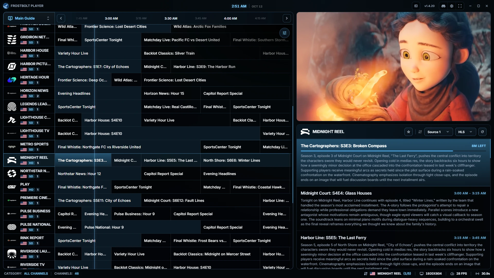
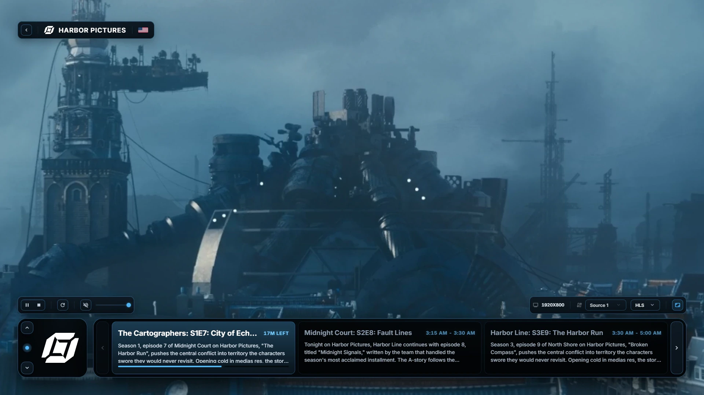

# Frostbolt Player

A desktop IPTV player for Windows. Browse your channels, see what's on, and watch from the TV guide. Works with Xtream, M3U playlists and Stalker portals (Portal / MAC).

**[Download for Windows](https://github.com/mitchivin/frostbolt-player/releases/latest) · [Website](https://frostbolt.xyz/)**

Current release: **1.4.20**. Free to use. Connect your own provider to get started.

## Features

- **Provider types.** Xtream, M3U playlists from a link or a local file, and Stalker portals (Portal / MAC). Add an XMLTV guide link if your provider's guide is missing.
- **TV guide.** Browse the main guide, Marathons (24/7 channels) and Live Events, when your provider has them.
- **Multiple sources per channel.** Keep matching feeds together, switch sources, and recover automatically when a feed fails.
- **Playlist management.** Choose what appears in your guide, rename channels, upload your own channel logos, and manage favourites and custom lists.
- **Programme information.** Choose guide data, hide channels with no guide data, and adjust timings when a schedule is out of sync.
- **Channel health checks.** Scan your list to find working and unavailable feeds.
- **Fullscreen controls.** See now-and-next programmes, switch between fit and zoom, and change channels or sources without leaving the video.
- **Playback engines.** HLS is built in. VLC can be used if it is installed.
- **Two dark themes.** Frostbolt and Regrowth.
- **Setup blueprints.** Export your channel names, categories and preferences to a file, and import them later.
- **Updates.** The installed app checks for new releases and offers to restart when one is ready.

## Get started

1. Download the Windows **Setup installer** from [Releases](https://github.com/mitchivin/frostbolt-player/releases/latest).
2. Connect your Xtream, M3U or Portal / MAC provider.
3. Choose your channels in the setup wizard and start watching.

The VLC playback engine needs [VLC media player](https://www.videolan.org/vlc/) installed. VLC is not included.

This repository contains public product information and release downloads. The application source is not published here.

## Related

- [DoodleDev](https://github.com/mitchivin/doodledev)
- [iPod Classic](https://github.com/mitchivin/ipod-classic)
- [iPod Original](https://github.com/mitchivin/ipod-original)
- [Game Boy Color](https://github.com/mitchivin/game-boy-color)
- [OP-XY](https://github.com/mitchivin/te-opxy)
- [OP-1 Field](https://github.com/mitchivin/te-op1-field)
- [MitchIvin XP](https://mitchivin.com/)

## About

Built by [Mitch Ivin](https://mitchivin.com/).

Frostbolt is a media player. It does not supply channels, playlists or subscriptions. Use a provider you are authorised to access.

Screenshots show fictional demo channels. Film stills: *Sintel* and *Tears of Steel*, © copyright [Blender Foundation](https://www.blender.org/about/projects/), used under [CC BY 3.0](https://creativecommons.org/licenses/by/3.0/).

Screenshots captured at 1920 × 1080.
